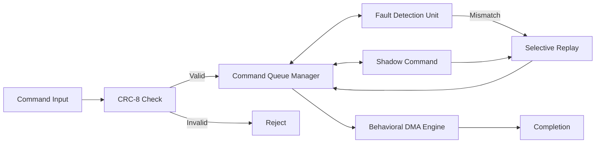

<div align="center">

<a href="https://github.com/ssanjay-be/FAULT-AWARE-NVMe-CONTROLLER-">

</a>

**A Verilog RTL research prototype for command-integrity monitoring and selective recovery in FPGA-based storage-controller logic.**


[](docs/VERIFICATION.md)

[Architecture](#-architecture) · [Features](#-key-features) · [Verification](#-verification) · [Conference Paper](#-conference-paper) · [Getting Started](#-getting-started)

</div>

---

## ✨ Project at a glance

| Item | Details |
|---|---|
| Project | Fault-Aware FPGA Storage-Controller RTL with Selective Command Replay |
| Research orientation | NVMe-oriented storage-controller datapath |
| RTL language | Verilog HDL |
| FPGA target | AMD/Xilinx Zynq-7000 `xc7z020clg400-1` |
| Main technique | CRC-8 command-integrity checking and shadow-command replay |
| Simulation | Vivado 2026.1 / XSim (reported environment) |
| Conference | ICSCDS 2026 |
| Paper ID | `ICSCDS-0406` |
| Paper status | **Accepted with Major Revision** |

> **Status note:** The reported conference decision is *Acceptance with Major Revision*. This is not a claim of final publication. Update this status if the conference issues a later decision.

## 🎯 Problem and proposed approach

A command may become corrupted before or during execution in a storage-controller datapath. Processing a corrupted command can cause incorrect control or data-transfer behaviour. Resetting an entire queue to recover one affected command may also interrupt unrelated pending work.

This prototype investigates a command-level approach:

1. Check the integrity of an incoming 32-bit command using CRC-8.
2. Preserve a clean command copy using a shadow-command mechanism.
3. Recheck the active command during processing.
4. Selectively replay the affected command when the implemented recovery condition is detected.

**CRC detects corruption; the replay mechanism performs recovery.**

## 🧩 Key features

- **CRC-8 checking:** Polynomial `0x07` (`x⁸ + x² + x + 1`), initial value `0x00`.
- **Shadow-command preservation:** Retains a copy of the original command for recovery.
- **Active-command monitoring:** Checks command integrity during execution.
- **Selective replay:** Targets the affected command rather than flushing the complete queue.
- **Directed RTL verification:** Exercises normal execution, ingress rejection, active-command corruption and ordered multi-command processing.

## 🏗️ Architecture



<details>
<summary><strong>What each RTL block does</strong></summary>

| Module | Responsibility |
|---|---|
| `top_controller.v` | Top-level integration |
| `cmd_queue_manager.v` | Queue management and replay coordination |
| `fault_unit.v` | CRC and fault-related checking/control |
| `dma_engine.v` | Behavioral DMA/data-transfer model |
| `tb_top.v` | Directed simulation testbench |

</details>

## 🧪 Verification

The project author reported the following directed XSim results for the corrected testbench:

| Test | Scenario | Reported result |
|---|---|---|
| T1 | Valid command execution | PASS |
| T2 | Invalid CRC at ingress; command rejected | PASS |
| T2 observation | No completion during the specified 10-cycle observation window | PASS |
| T3 | SEU-inspired active-command bit flip and replay | PASS |
| T4 | A–B–C sequence with B corrupted; exactly-once directed check | PASS |

<div align="center">


</div>

<details>
<summary><strong>Verification scope and limitations — read before citing results</strong></summary>

- These are directed behavioral RTL tests, not formal verification.
- The T2 observation checks for no completion during a ten-cycle window; it does not prove that a rejected command can never complete later.
- The SEU-inspired event is a simulated bit flip, not physical radiation testing.
- The tests do not establish exhaustive multi-bit, burst, timing or state-corruption coverage.
- The shadow command and recovery state are not independently protected in this prototype.

See [docs/VERIFICATION.md](docs/VERIFICATION.md).

</details>

## ⚙️ Implementation notes

The project includes RTL simulation and Vivado implementation analysis. The DMA/memory behaviour is modeled in RTL.

When reporting implementation figures, identify the exact RTL revision, target part, Vivado version and constraints used. Historical figures from an earlier revision must not be attributed to the current source unless the implementation flow has been rerun.

<details>
<summary><strong>Timing, I/O and power reporting cautions</strong></summary>

- Positive WNS/WHS applies only to paths covered by active timing constraints.
- Missing input/output delays mean external interface timing is not fully assessed.
- NSTD-1 and UCIO-1 warnings indicate missing I/O-standard and package-pin assignments. Use the actual board schematic and bank-voltage requirements before assigning pins.
- Vectorless power analysis is an estimate, not measured board power. State its activity assumptions and confidence level.

See [docs/IMPLEMENTATION_NOTES.md](docs/IMPLEMENTATION_NOTES.md).

</details>

## 🚀 Getting started

### Requirements

- AMD/Xilinx Vivado (reported environment: 2026.1)
- Target part, if reproducing the stated setup: `xc7z020clg400-1`

### Create the Vivado project

1. Clone or download this repository.
2. Open Vivado and its Tcl Console.
3. Change directory to the repository root.
4. Run:

```tcl
source vivado/create_project.tcl
```

5. Run **Run Behavioral Simulation**.
6. Inspect the transcript and waveform.

**Top-module reminder:** `top_controller` is the synthesizable design top. `tb_top` is the simulation testbench and must not be selected as the synthesis top.

<details>
<summary><strong>Manual project setup</strong></summary>

1. Create a new RTL project.
2. Add all four files in `rtl/` as Design Sources.
3. Set `top_controller` as the design top.
4. Add `sim/tb_top.v` as a Simulation Source.
5. Set `tb_top` as the simulation top.
6. Run behavioral simulation.

</details>

## 📄 Conference paper

<div align="center">

### ICSCDS 2026

**Paper ID: `ICSCDS-0406`**


*Fault-Aware FPGA Storage-Controller RTL with Selective Command Replay: An NVMe-Oriented Simulation and Implementation Study*

</div>

The reported decision was **Acceptance with Major Revision**. This repository does not include the unpublished manuscript, acceptance letter, reviewer correspondence or other confidential submission documents.

## 📁 Repository structure

```text
.
├── rtl/
│   ├── top_controller.v
│   ├── cmd_queue_manager.v
│   ├── dma_engine.v
│   └── fault_unit.v
├── sim/
│   └── tb_top.v
├── vivado/
│   └── create_project.tcl
├── docs/
│   ├── ARCHITECTURE.md
│   ├── VERIFICATION.md
│   ├── IMPLEMENTATION_NOTES.md
│   └── SHA256SUMS.txt
├── .github/
│   └── ISSUE_TEMPLATE/
│       └── bug_report.md
├── .gitattributes
├── .gitignore
└── README.md
```

## 🔭 Future work

- Protect the shadow command and recovery-control state.
- Extend multi-bit and burst-error evaluation.
- Add stronger verification, including assertions and broader coverage.
- Integrate PCIe/NVMe interfaces.
- Validate on a physical FPGA development board.
- Measure power using representative switching activity and, eventually, board-level measurements.

## 📚 Citation and reuse

Project title: *Fault-Aware FPGA Storage-Controller RTL with Selective Command Replay: An NVMe-Oriented Simulation and Implementation Study.*

Use the final bibliographic details supplied by the authors or the official proceedings record if citing this work. No open-source license is included; obtain agreement from all project authors and the supervisor before selecting a license or authorizing reuse.

---

<div align="center">

**Built for FPGA reliability research and reproducible RTL experimentation.**

<sub>Verilog HDL · CRC-8 · Command Integrity · Selective Replay · Vivado</sub>

</div>
