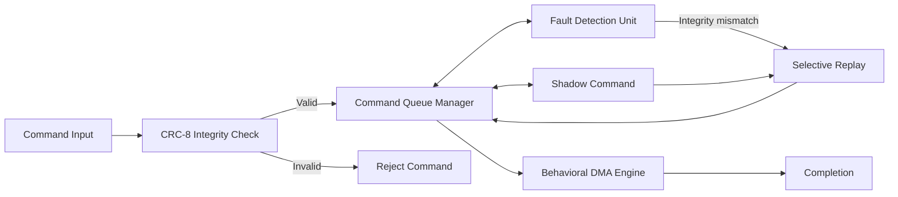

<div align="center">

# Fault-Aware FPGA Storage Controller

### CRC-8 Command Integrity Checking · Shadow-Command Recovery · Selective Replay

**An NVMe-oriented RTL simulation and implementation study**


</div>

---

## Overview

This repository contains a Verilog RTL prototype that investigates command-level integrity checking and selective command replay in an FPGA-based, NVMe-oriented storage-controller datapath.

The design combines:

- **CRC-8 integrity checking** for 32-bit command data.
- **Shadow-command preservation** to retain a clean command copy.
- **Active-command integrity rechecking** to detect corruption during processing.
- **Selective replay** to recover the affected command without flushing the complete command queue.

The project is a research prototype. It is **not a complete NVMe controller**, PCIe endpoint, or production SSD implementation.

## Architecture



The diagram is a conceptual view of the prototype. Consult the RTL for the exact signal-level implementation.

## Repository layout

```text
.
├── rtl/
│   ├── top_controller.v
│   ├── cmd_queue_manager.v
│   ├── dma_engine.v
│   └── fault_unit.v
├── sim/
│   └── tb_top.v
├── vivado/
│   └── create_project.tcl
├── docs/
│   ├── ARCHITECTURE.md
│   ├── VERIFICATION.md
│   ├── IMPLEMENTATION_NOTES.md
│   └── SHA256SUMS.txt
├── .github/
│   └── ISSUE_TEMPLATE/
│       └── bug_report.md
├── .gitattributes
├── .gitignore
└── README.md
```

## RTL modules

| File | Responsibility |
|---|---|
| `rtl/top_controller.v` | Top-level integration of the controller modules |
| `rtl/cmd_queue_manager.v` | Command queue management, command-state handling and replay coordination |
| `rtl/dma_engine.v` | Behavioral DMA/data-transfer model used by this prototype |
| `rtl/fault_unit.v` | CRC-8 checking and fault-related control logic |
| `sim/tb_top.v` | Directed behavioral testbench |

## CRC configuration

The supplied RTL uses CRC-8 with:

- Polynomial: `0x07`
- Polynomial expression: \(x^8 + x^2 + x + 1\)
- Initial value: `0x00`
- Protected command width: 32 bits

CRC is an **error-detection** mechanism. Recovery is performed by the controller's shadow-command and replay logic; CRC itself does not correct data.

## Run the project in Vivado

### Requirements

- AMD/Xilinx Vivado (the reported simulation environment was Vivado 2026.1).
- A Windows or Linux environment supported by your Vivado installation.

### Option A — Create the project using Tcl

1. Clone or download this repository.
2. Open Vivado.
3. Open the Tcl Console.
4. Change directory to the repository root:

   ```tcl
   cd /path/to/fault-aware-fpga-storage-controller
   ```

5. Source the project script:

   ```tcl
   source vivado/create_project.tcl
   ```

6. In **Flow Navigator**, select **Run Simulation → Run Behavioral Simulation**.
7. Allow the testbench to finish and inspect the simulation transcript and waveform.

The script adds the four synthesizable modules as design sources, sets `top_controller` as the synthesis top, and adds `tb_top.v` separately as the simulation top.

### Option B — Create the project manually

1. Create a new RTL project.
2. Select target part `xc7z020clg400-1` if reproducing the stated target.
3. Add the four files under `rtl/` as **Design Sources**.
4. Set `top_controller` as the design top.
5. Add `sim/tb_top.v` under **Simulation Sources**.
6. Set `tb_top` as the simulation top.
7. Run behavioral simulation.

> **Important:** `tb_top` is a testbench and must not be used as the synthesis top. `top_controller` is the synthesizable design top.

## Reported directed simulation

The project author reported the following results from the corrected testbench in Vivado 2026.1 / XSim:

| Test | Scenario | Reported result |
|---|---|---|
| T1 | Valid command execution | PASS |
| T2 | Bad CRC at ingress | PASS — rejected |
| T2 observation | No completion during the specified 10-cycle window | PASS |
| T3 | SEU-inspired active-command bit flip and replay | PASS |
| T4 | A–B–C sequence with B corrupted; exactly-once directed check | PASS |

**Reported summary:** 4/4 directed scenarios passed, five successful command completions, and zero failed testbench assertions.

These are directed behavioral simulation results, not formal verification or exhaustive fault coverage. The 10-cycle T2 observation does not prove that a rejected command can never complete at any later time.

See [`docs/VERIFICATION.md`](docs/VERIFICATION.md) for the test interpretation and limitations.

## Implementation scope and limitations

The project includes RTL simulation and Vivado implementation analysis. The DMA/memory behavior is modeled in RTL.

The current repository does not implement or claim:

- A complete standards-compliant NVMe controller.
- A PCIe endpoint or full host/device protocol stack.
- Physical FPGA-board validation.
- Physical radiation or SEU fault injection.
- Exhaustive multi-bit or burst-fault tolerance.
- Independent protection of the shadow command and recovery state.

Any resource, timing, or power numbers must be tied to the exact RTL revision, target part, constraints, and Vivado reports used to produce them. Historical figures from an earlier revision must not be presented as measurements of this repository without rerunning the implementation flow.

## Reproducibility

- Source-file SHA-256 checksums are provided in [`docs/SHA256SUMS.txt`](docs/SHA256SUMS.txt).
- The Vivado project-generation script is in [`vivado/create_project.tcl`](vivado/create_project.tcl).
- Verification scope and caveats are documented in [`docs/VERIFICATION.md`](docs/VERIFICATION.md).
- Implementation reporting guidance is in [`docs/IMPLEMENTATION_NOTES.md`](docs/IMPLEMENTATION_NOTES.md).

## Research context and citation

This repository accompanies the project:

*Fault-Aware FPGA Storage-Controller RTL with Selective Command Replay: An NVMe-Oriented Simulation and Implementation Study.*

If citing this work, use the final bibliographic details supplied by the authors or the published proceedings record. Do not invent publication metadata.

Do not upload unpublished manuscripts, acceptance letters, reviewer correspondence, payment confirmations, or other confidential conference material unless all authors and the relevant venue explicitly permit public release.

## License

No open-source license is included. Obtain agreement from the project authors and supervisor before selecting a license or making the source publicly reusable. Until a license is added, normal copyright restrictions apply.

---

<div align="center">

**Research prototype · Verilog RTL · FPGA implementation study**

</div>
